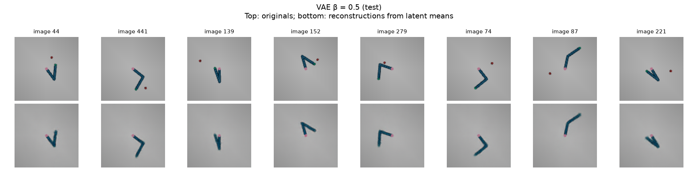
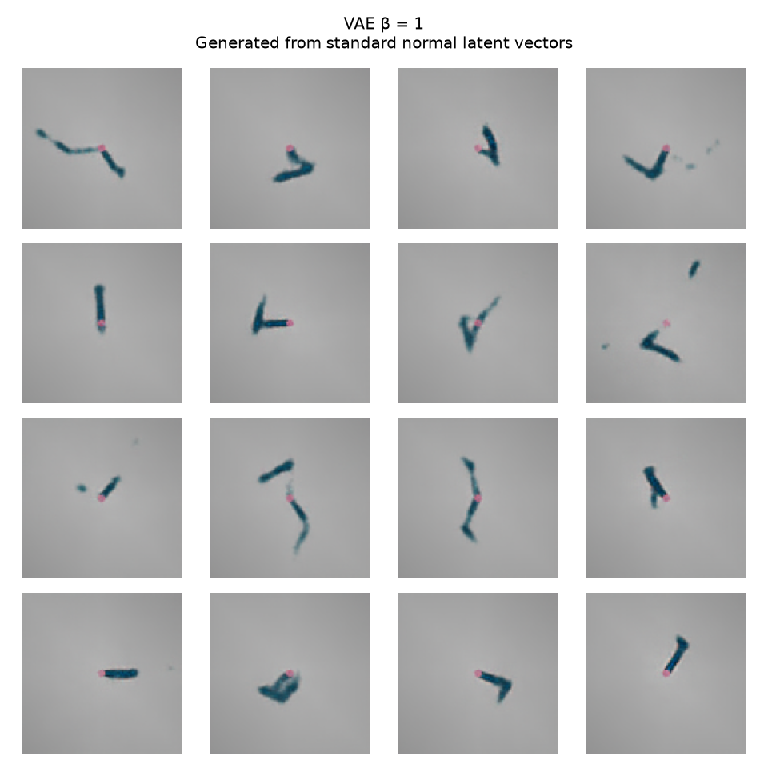

# Reacher VAE: reconstructing and generating robot-arm images

Can an image of a robot arm be compressed into eight latent numbers, reconstructed, and generated from random
latent samples? This project trains a convolutional variational autoencoder (VAE) on MuJoCo Reacher images and
compares four weights on its KL regularization term: **β = 0, 0.5, 1, and 4**.

**β = 0.5 has the lowest test reconstruction error among the saved models.** β = 0.5 and β = 1 capture recognizable
arm poses, but often omit the small red target. Randomly generated images contain malformed arms and missing details.
β = 0 and β = 4 produce nearly constant reconstructions. The runs used different training budgets, so these results
describe the saved checkpoints rather than isolate the effect of β.



*Top: eight original test images. Bottom: reconstructions from latent means. Arm poses are largely preserved;
the separate red target is lost. The pink marker attached to the arm is its fingertip.*

## Dataset

Reuse the [Reacher fingertip dataset](../reacher_fingertip/README.md#dataset-how-it-was-made) at
`data/reacher_5000_s0.npz`: 5,000 independent 96 × 96 RGB images from a fixed top-down camera, with randomized arm
poses and target positions. These are individual images rather than trajectories.

| Split | Images | Purpose |
|---|---:|---|
| Training | 4,000 | Optimize the model |
| Validation | 500 | Select each run's best checkpoint |
| Test | 500 | Evaluate the selected checkpoints |

The [VAE dataset loader](../../physai/datasets/reacher_vae_torch.py) preserves the stored splits, converts uint8 RGB
images to channel-first float tensors in [0, 1], and applies no resizing or augmentation. It uses images only;
fingertip, joint, and target labels are not supplied to the VAE. The red target remains in the images and contributes
to the reconstruction loss.

## Model and loss

Implementation: [`physai/models/vae.py`](../../physai/models/vae.py), with **1,610,451 trainable parameters**.

| Stage | Operation |
|---|---|
| Encoder | Four stride-2 convolution layers, channels 3 → 32 → 64 → 128 → 256; spatial size 96 → 48 → 24 → 12 → 6 |
| Latent distribution | Separate linear heads predict eight means (`mu`) and eight log variances (`logvar`) |
| Reparameterization | `z = mu + exp(0.5 * logvar) * noise`, with standard-normal noise |
| Decoder | Linear projection to 256 × 6 × 6, then four transposed convolution layers to 3 × 96 × 96 |
| Output | Sigmoid restricts reconstructed RGB values to [0, 1] |

ReLU activations follow the hidden convolutions and decoder projection. Training uses sampled latent vectors.
Setting `sample=False` reconstructs from the latent mean; calling `eval()` alone does not turn sampling off.

```text
total loss = reconstruction loss + β × KL divergence
```

- **Reconstruction loss:** sum squared errors over all RGB pixels in each image, then average over the batch.
- **KL divergence:** KL between the encoded diagonal Gaussian and N(0, I), summed over the eight latent dimensions
  and averaged over the batch.
- **Pixel MSE:** reconstruction loss / (3 × 96 × 96), or reconstruction loss / 27,648.

At β = 0, KL is reported but omitted from the objective. Latent sampling still occurs, so this case is not a
deterministic autoencoder. Increasing β strengthens the pressure toward the standard-normal prior; it does not
guarantee better images.

## Training and checkpoint selection

[`train.py`](train.py) uses Hydra for configuration, Hugging Face Accelerate for execution, and Weights & Biases
for logging. Common settings in the four saved checkpoints are seed 0, batch size 64, Adam with learning rate 1e-3,
eight latent dimensions, and no mixed precision.

The current [training config](configs/train.yaml) allows up to 100 epochs and stops after 10 consecutive epochs
without a lower total validation loss. Validation uses sampled latents with repeatable noise. Each run saves
`best.pt` and `last.pt` in its Hydra output directory, then copies the best checkpoint to
`checkpoints/vae/vae_beta<beta>_s0.pt`.

The existing checkpoints were trained under two versions of the settings:

| β | Configured maximum epochs | Early-stopping patience in checkpoint config | Selected epoch (1-based) |
|---|---:|---|---:|
| 0 | 50 | Not recorded in the older config | 38 |
| 0.5 | 100 | 10 | 99 |
| 1 | 100 | 10 | 97 |
| 4 | 50 | Not recorded in the older config | 26 |

The selected epoch is the best checkpoint's epoch, not necessarily the final training epoch. Only one seed is
reported. A controlled β comparison needs matching training budgets and repeated seeds.

## Evaluation and test cases

[`evaluate.py`](evaluate.py) loads all four named checkpoints by default. Evaluation completed on **20 October 2026**
using all 500 test images and evaluation seed 0. It performs inference and does not update model weights or log to W&B.

| Test case | Procedure | What it checks |
|---|---|---|
| Test-set metrics | Reconstruct all 500 test images using sampled latents; report total loss, reconstruction loss, pixel MSE, and KL | Reconstruction accuracy and latent regularization |
| Reconstruction figures | Use the same eight test images for every model and decode their latent means | Whether arm pose and small details survive compression |
| Generation figures | Decode the same 16 standard-normal latent vectors for every model | Whether prior samples produce varied, recognizable images |

Sampling seeds are reset for each model to make comparisons repeatable. Reconstruction figures use latent means,
so their images are not the exact sampled reconstructions used to compute the metrics.

### Test results

| β | Total loss | Reconstruction loss | Pixel MSE | KL divergence |
|---|---:|---:|---:|---:|
| 0 | 108.2981 | 108.2981 | 0.003917 | 24.9466 |
| **0.5** | 25.3919 | **16.3113** | **0.000590** | 18.1611 |
| 1 | 33.8686 | 19.6296 | 0.000710 | 14.2390 |
| 4 | 108.3176 | 108.3174 | 0.003918 | ≈ 0.000050 |

Compare reconstruction and KL separately: total loss uses a different β in each row. The evaluation-generated
[results table](figures/eval/results.md) rounds β = 4's small, nonzero KL to `0.0000`.

### Reading the figures

There are **two PNG files per β**, eight figures in total:

- **Reconstructions:** eight originals on the top row and their eight reconstructions on the bottom row.
- **Generated:** a 4 × 4 grid of 16 new images decoded from random latent vectors, with no input images or matching originals.

| β | Original/reconstruction pairs | Random generation |
|---|---|---|
| 0 | [Reconstructions](figures/eval/0_beta0_reconstructions.png) | [Generated images](figures/eval/0_beta0_generated.png) |
| 0.5 | [Reconstructions](figures/eval/1_beta0.5_reconstructions.png) | [Generated images](figures/eval/1_beta0.5_generated.png) |
| 1 | [Reconstructions](figures/eval/2_beta1_reconstructions.png) | [Generated images](figures/eval/2_beta1_generated.png) |
| 4 | [Reconstructions](figures/eval/3_beta4_reconstructions.png) | [Generated images](figures/eval/3_beta4_generated.png) |



*β = 1 produces varied arm-like shapes, but some have disconnected pieces or distorted geometry. Recognizable
reconstructions do not guarantee realistic random samples.*

## Findings and limitations

- **β = 0.5 gives the lowest reconstruction error among these checkpoints.** β = 1 also preserves recognizable arm
  poses, with lower KL and somewhat higher reconstruction error.
- **β = 4 shows strong evidence of posterior collapse.** Near-zero KL and nearly identical outputs suggest the latent
  distribution carries little information about the input.
- **β = 0 also fails to reconstruct different inputs distinctly.** Its KL is not near zero, so the same diagnosis
  does not follow. The cause needs investigation; removing KL alone did not produce a useful model in this run.
- **Small details are easy to miss.** The red target contributes few pixels to the full-image loss. Its omission
  illustrates why low pixel MSE is insufficient for judging whether a representation preserves task-relevant information.
- **Generation quality remains limited.** Visual inspection reveals malformed arms and missing targets. There is no
  quantitative generation-quality or geometry-validity score in the current evaluation, and no evidence yet that the
  latent representation is suitable for robot control.

Potential next experiments are a deterministic autoencoder baseline, matching training settings across β values,
multiple seeds, KL warm-up, foreground-weighted reconstruction loss, and larger or spatial latent representations.
These are proposed improvements, not implemented results.

## Commands

Run from the repository root after the [shared setup](../../README.md#setup). Datasets and model checkpoints are
local artifacts excluded from git.

```bash
# Create the existing image dataset if it is not already present.
uv run python -m physai.datasets.reacher --n 5000 --size 96 --seed 0 \
    --out data/reacher_5000_s0.npz

# Train one beta case using the current settings.
uv run python projects/vae/train.py beta=0.5

# Train all four cases using the current 100-epoch / patience-10 settings.
uv run python projects/vae/train.py -m

# Disable W&B for a training run if desired.
uv run python projects/vae/train.py beta=0.5 tracker=null

# Evaluate all four saved models.
uv run python projects/vae/evaluate.py

# Evaluate one model, or change the figure counts.
uv run python projects/vae/evaluate.py 'checkpoints=[checkpoints/vae/vae_beta0.5_s0.pt]'
uv run python projects/vae/evaluate.py num_examples=12 num_generated=25
```

Training copies its best model to the named checkpoint path, replacing an existing checkpoint with the same run name.
Use a different `run_name` or `checkpoint_dir` to preserve earlier runs. Evaluation writes figures and `results.md`
to `projects/vae/figures/eval/` by default; set `out_dir` to keep a separate evaluation. Rerunning the current training
commands will use the current settings rather than reproduce the older 50-epoch runs exactly.

## Files

| File | Purpose |
|---|---|
| [`physai/models/vae.py`](../../physai/models/vae.py) | Encoder, reparameterization, decoder, and loss |
| [`physai/datasets/reacher_vae_torch.py`](../../physai/datasets/reacher_vae_torch.py) | Image-only dataset loader |
| [`train.py`](train.py) | Training, validation, logging, early stopping, and checkpoint saving |
| [`evaluate.py`](evaluate.py) | Test metrics, reconstructions, and prior-sample generation |
| [`configs/train.yaml`](configs/train.yaml), [`configs/model/vae.yaml`](configs/model/vae.yaml) | Training and architecture settings |
| [`configs/eval.yaml`](configs/eval.yaml) | Checkpoints, split, example counts, and output directory |
| [`figures/eval/`](figures/eval/) | Evaluation figures and results table |
